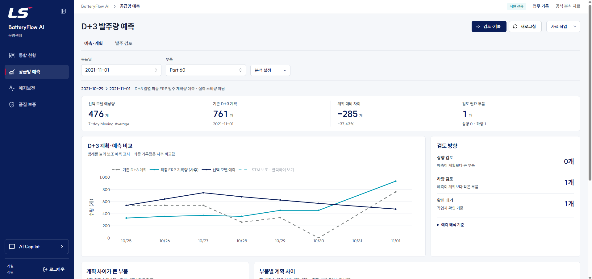
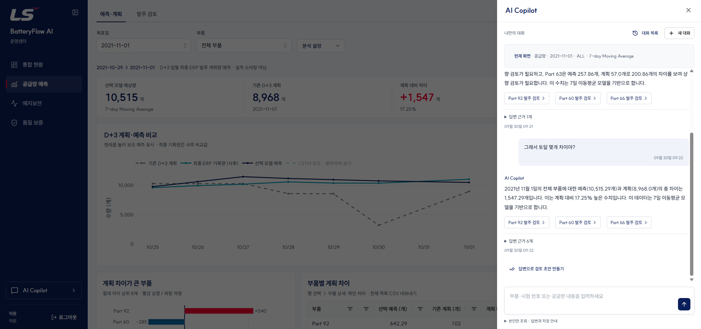
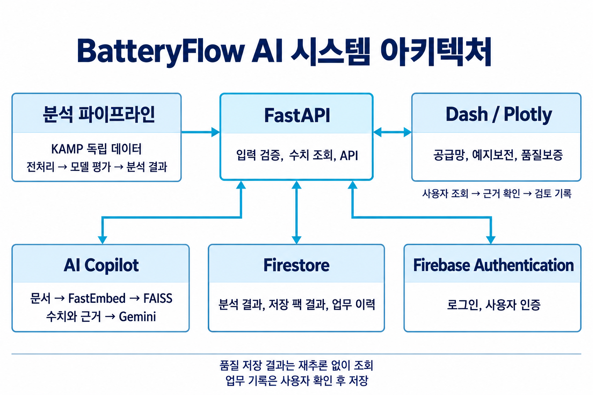

# BatteryFlow ML Platform

**예측 시점의 데이터 검증부터, 근거를 확인하고 계획을 검토하는 서비스까지.**

KAMP 제조 데이터를 활용한 공급망·예지보전·품질 분석 플랫폼입니다. 3인 팀 프로젝트 **BatteryFlow AI**에서 제가 담당한 발주량 예측, AI Copilot, FastAPI 백엔드, Dash 화면 구현·통합을 중심으로 정리한 개인 포트폴리오입니다.

| 항목 | 내용 |
|---|---|
| 작성자 / 관심 직무 | 김유빈 · 데이터 분석 / 머신러닝 엔지니어 |
| 팀 개발 기간 | 2026.09.21–09.30 · 이후 개인 포트폴리오로 개선 |
| 서비스 목적 | 기존 발주 계획과 최근 패턴의 차이를 찾아 검토를 지원 |
| 주요 기술 | Python · pandas · scikit-learn · XGBoost · PyTorch · FastAPI · Dash · Plotly · Gemini · FastEmbed / FAISS · Firebase |

[포트폴리오 핵심 내용](portfolio_notes/01_포트폴리오_핵심내용.md) · [실행 안내](GETTING_STARTED.md) · [모델 평가 보고서](<발주량 예측 모델/docs/RETRAINING_REPORT_2026-09-27.md>)



*부품·목표일별 예측과 기존 D+3 계획을 비교하는 화면. 팀 개발 최종 화면의 보존 캡처입니다.*

## 제가 해결한 문제

### 1. 목표값 충돌과 시간 누수를 바로잡은 평가

동일 부품·시각의 수량 충돌과, D+3 예측 시점에 알 수 없는 정답이 학습에 포함될 가능성을 발견했습니다.

- 원본 17,364행·117개 부품에서 충돌 306개 그룹을 보존하고 Part 21·26을 격리했습니다. 0은 유지하고 관측이 없는 날짜는 0으로 채우지 않았습니다.
- 예측 기준일(`origin_date`)과 목표일(`target_date`)을 분리했습니다. **학습 정답의 마지막 날짜가 다음 검증의 첫 예측 기준일보다 앞서는지** 검사했습니다.
- 내부 검증으로 설정을 선택한 뒤, 4개 목표일씩 3회의 외부 시간순 검증에서 9가지 방법을 비교했습니다. 최종 시험 정답을 이용한 부품별 모델 선택도 제거했습니다.

115개 부품·5,380개 일별 관측을 구성했으며, 공통 CV 평가는 **112개 부품·1,289행·12개 목표일**입니다. Part 45·109·111은 CV 목표 기간에 정답 관측이 없어 제외됐습니다.

| 비교 방법 | MAE (개) | RMSE (개) | WAPE |
|---|---:|---:|---:|
| 7일 이동평균 · 검토 기준선 | 34.7 | 69.7 | 35.7% |
| LSTM · 학습형 보조 모델 | 35.2 | 70.3 | 36.3% |
| 3일 이동평균 | 35.4 | 79.8 | 36.4% |
| 기존 D+3 계획 | 54.8 | 132.2 | 56.4% |

전체 CV에서 7일 평균의 MAE는 기존 계획보다 36.7% 낮았습니다. 다만 목표일 단위 bootstrap 95% 구간은 **−13.6%~59.2%**로 0을 포함했고, 첫 구간을 제외하면 오차가 기존 계획보다 **16.4% 컸습니다**. 따라서 서비스에서는 7일 평균을 **최근 패턴과 크게 다른 계획을 찾아내는 검토 기준선**으로 사용합니다.

LSTM은 3일 입력으로 학습형 후보 중 가장 낮은 MAE를 보였습니다. 저는 더 긴 관측 이력이 확보되면 학습 자료와 입력 기간을 늘려 개선 가능성을 검증할 가치가 있다고 판단해 **학습형 보조 모델로 유지하자고 제안했습니다**. 새 기간에서 트리 모델과 함께 비교할 가설입니다.

[전체 비교표](<발주량 예측 모델/outputs/audited_v2/source_total/cv_metrics_pooled.csv>) · [신뢰구간과 구간 제외 분석](portfolio_notes/evidence/baseline_comparison.json)

### 2. 학습과 서비스 추론의 입력 계약 통일

학습과 추론에서 `demand_contract.py`의 특징 생성 규칙을 공유합니다. 모델·전처리기·메타데이터와 원본/코드 해시를 함께 보존해 결과를 추적합니다.

FastAPI에서 한 부품의 3~60일 이력을 받아 연속 날짜·중복·음수·무한대·필수 열을 검사하고, Dash의 **CSV 검사 → 예측 → 계획 비교 → 검토 기록** 흐름으로 연결했습니다.

### 3. Copilot의 수치와 순위 오류 해결

“계획과 차이가 큰 부품 3개”를 물었을 때 LLM이 증가 부품 위주로 답하고 감소 부품을 누락했습니다. 키워드 확인만 하던 검사로는 실제 순위 오류를 잡지 못했습니다.

공식 분석 자료의 수치 조회와 FastEmbed·FAISS 문서 검색을 분리하고, 순위와 핵심 수치 문장을 서버에서 확정하도록 바꿨습니다. **차이 절댓값 내림차순 → 동률이면 부품 번호 오름차순**을 API와 Copilot이 공유합니다.

2021-11-01 기준 검증 결과는 **Part 92 → Part 60 → Part 66**, 차이는 **+540.29 / −284.86 / −284.86개**입니다. 입력 순서를 바꾸거나 상위 3개 경계에서 동률이 발생해도 규칙을 유지하는지 검사했습니다.



*저장된 분석 자료에 근거한 합계 설명과 검토 링크. 팀 개발 최종 화면의 보존 캡처입니다.*

### 4. 분석 근거와 안전한 검토 기록 연결

- 같은 목표일의 계획 변경을 D-5~D-1 순서로 정렬하고 예측 당시 정보와 사후 정보를 구분했습니다.
- `dataVersion`으로 분석 근거 변경, `expectedRevision`으로 동시 수정 충돌을 확인합니다. `requestId`로 재전송에 따른 중복 저장을 방지합니다.
- 부품 전환 시 이전 메모가 남던 문제는 대상별 상태 재조회와 편집 상태 분리로 해결했습니다. 저장 실패 시 작성 내용을 유지합니다.
- 개인 포트폴리오에서는 가입 없는 **포트폴리오 둘러보기**, 방문자별 Copilot 사용량 제한, 업무 기록 쓰기 차단을 추가했습니다.

## 역할과 시스템 구성

| 담당 | 역할 |
|---|---|
| **김유빈 (본인)** | 공급망 데이터 검증·발주량 예측, AI Copilot, FastAPI 백엔드, Dash 화면 구현·통합 |
| 유현경 | 예지보전 모델·디자인 |
| 최우찬 | 품질보증 모델·Firestore |

팀의 예지보전·품질 분석 결과를 공통 서비스에 연결했습니다. 품질 화면은 저장된 팩 분석 결과를 조회하며, 현재 연구 모델로 재계산한 결과라고 소개하지 않습니다.



*직원 모드의 분석·인증·검토 기록 구성. 개인 포트폴리오 모드는 별도의 방문자 세션과 SQLite 사용량 저장소를 사용합니다.*

## 실행해 보기

Python **3.12** 환경에서 다음 순서로 실행합니다. 학습을 다시 수행하지 않고 저장된 모델·분석 자료를 사용합니다.

```powershell
py -3.12 -m venv .venv
.venv\Scripts\python.exe -m pip install -r requirements-local.txt
Copy-Item .env.example .env
.venv\Scripts\python.exe run_local.py --portfolio --port 8071
```

`http://127.0.0.1:8071/login`에서 **포트폴리오 둘러보기**를 선택합니다. 새 설치의 기본 데이터 소스는 포함된 로컬 자료입니다. 분석 조회·CSV 예측은 키 없이 사용할 수 있고, 실제 Copilot에는 `.env`의 `PORTFOLIO_GEMINI_API_KEY`가 필요합니다. 최초 검색 모델 다운로드에는 네트워크가 필요합니다.

| 실행 방식 | 용도 |
|---|---|
| `start_portfolio.cmd` · 8071 | 가입 없는 포트폴리오, 방문자 하루 5회 Copilot, 업무 기록 읽기·쓰기 차단 |
| `start_local.cmd` · 8078 | 본인 Firebase Authentication의 직원/관리자 로그인, 검토 기록·관리자 로그 |
| `start_demo.cmd` · 8070 | 외부 서비스 연결 없는 화면·CSV 추론 확인 |

개인 환경의 분석 데이터는 본인 소유 Firestore로 이전했습니다. GitHub 파일에 인증 키·계정 비밀번호·직원 로그·방문자 대화는 포함하지 않습니다. **공개 서비스 배포 주소는 아직 없습니다.**

[Firebase·Copilot 설정 및 검증 명령](GETTING_STARTED.md) · [방문자 한도와 배포 조건](PORTFOLIO_RUN.md)

## 코드와 근거 찾아보기

```text
backend/                       FastAPI · 인증 · 분석 조회 · Copilot · 회귀 검사
frontend/                      Dash 업무 화면
runtime/                       서비스에 필요한 저장 모델·압축 분석 자료
firestore/seed/                공식 분석 시드와 버전·해시
발주량 예측 모델/               학습 코드 · 평가 결과 · 모델 아티팩트
portfolio_notes/evidence/      bootstrap · 구간 제외 · 동률 순위 검증
portfolio_notes/assets/        화면 캡처와 구성도
```

- [학습·추론 계약](<발주량 예측 모델/src/demand_contract.py>) / [평가 파이프라인](<발주량 예측 모델/src/retrain_audited.py>)
- [Copilot 수치 조회와 답변](backend/copilot_search.py) / [공통 순위 규칙](backend/demand_ranking.py)
- [검토 기록의 동시성·중복 방지](backend/firebase_service.py) / [방문자 한도](backend/portfolio_service.py)
- [회귀 검사](backend/tests) / [데이터 출처](<발주량 예측 모델/DATA_SOURCES.md>)

## 분석 범위와 배운 점

1. **관측일 49일:** 장기 계절성과 새 기간의 안정성은 추가 데이터로 평가할 과제입니다.
2. **정답은 일별 최종 ERP 발주 계획량:** 실측 소비량과 구분해 계획 검토를 지원합니다.
3. **마지막 7개 목표일은 회고 평가:** 이전 실험에서 확인한 기간이므로 새 기간의 독립 평가가 필요합니다.

모델 종류보다 정답의 의미와 정보 이용 시점을 먼저 고정해야 했습니다. 평균 지표와 기간별 변동을 함께 확인하면서, 실제 근거에 맞춰 서비스의 역할을 정했습니다. 생성형 AI는 구현 초안과 수정에 활용했으며, 시간 경계·실패 사례·정렬 규칙을 코드와 저장 예측·회귀 검사로 확인했습니다.

이 저장소는 [원 팀 프로젝트](https://github.com/LS-PROEJCT-TEAM1/Predictive_Maintenance)에서 발전시킨 개인 포트폴리오입니다. 데이터는 KAMP의 공급망 최적화·배터리팩 예지보전·품질보증 자료를 바탕으로 합니다. 팀원의 분석 기여와 원 데이터 출처를 유지합니다. 과거 실행 복사본, 계정 자료, 개인 학습 노트 전체와 대용량 원본은 공개 묶음에서 제외했습니다.
