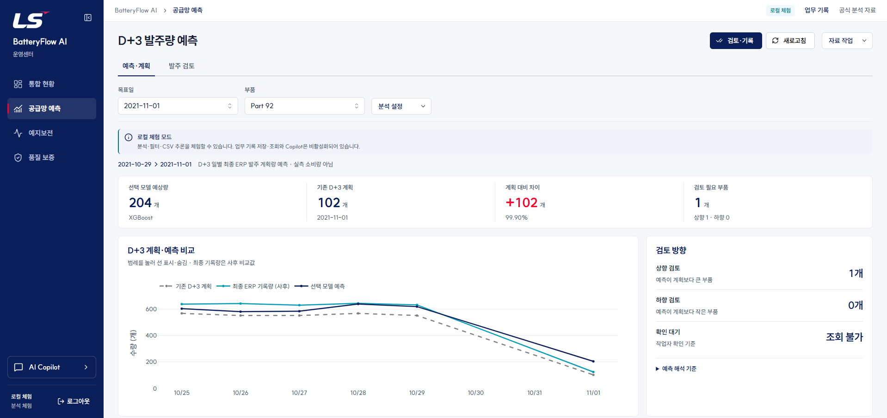
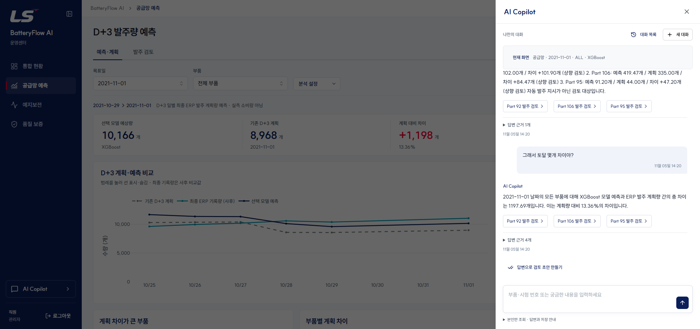
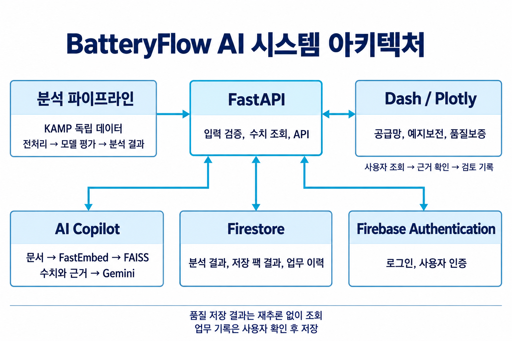

# 김유빈 | BatteryFlow AI

## 예측 시점에 맞게 데이터를 검증하고, 분석 결과를 업무 화면으로 연결했습니다

KAMP 공급망 데이터의 D+3 발주량 예측에서 **정답 충돌과 시간 누수를 발견하고 검증 설계를 수정**했습니다. 이후 원본 로그를 날짜별로 대조해 **휴무일 계획표가 이월된 구조**를 찾았습니다. 그 결과 "7일 이동평균이 기존 계획보다 낫다"던 결론을 철회하고 9가지 방법을 다시 비교했습니다. FastAPI·Dash·AI Copilot으로 조회부터 검토 기록까지 연결했습니다.

| 항목 | 내용 |
|---|---|
| 프로젝트 | BatteryFlow AI 운영센터 · 사랑의 밧데리, 3명 |
| 개발 기간 | 2026.09.21–09.30 |
| 본인 담당 | 발주량 예측 모델, FastAPI 백엔드, Dash 구현·통합, AI Copilot |
| 분석 기술 | Python, pandas, scikit-learn, XGBoost, LightGBM, CatBoost, PyTorch |
| 서비스 기술 | FastAPI, Dash, Plotly, Gemini API, FastEmbed, FAISS, Firebase |

**역할 분담:** 김유빈은 공급망 분석과 서비스 구현·통합, 유현경은 예지보전과 디자인, 최우찬은 품질보증과 Firestore를 담당했습니다. 각자의 분석 결과와 화면을 통합 브랜치에서 연결했습니다.

## 1. 정답과 시간 경계를 다시 정의한 모델 평가

### 문제와 해결

원본 17,364행·84열·117개 부품에서 동일 부품·시각의 수량 충돌을 발견했습니다. 기존 분할은 목표일 순서만 지켜, D+3 예측 시점에 아직 알 수 없는 정답이 학습에 포함될 수 있었습니다.

- 충돌 306개 그룹·612행을 별도로 보존하고 Part 21·26을 격리했습니다. 수량 0은 유지하고 누락 날짜는 0으로 채우지 않았습니다.
- `origin_date`와 `target_date`를 분리해 **학습 정답의 마지막 날짜 < 다음 검증의 첫 예측 기준일**을 검사했습니다.
- 내부 검증으로 설정을 선택하고, 4개 목표일씩 3회의 외부 시간순 검증을 수행했습니다. 시험 정답을 본 부품별 모델 선택을 제거하고 공통 정책으로 비교했습니다.

이 설계(audited_v2)에서는 7일 이동평균의 MAE가 기존 D+3 계획보다 36.7% 낮게 나왔습니다. 그래서 7일 평균을 검토 기준선, LSTM을 학습형 보조 모델로 제안했습니다. 아래 검증 결과에 따라 **두 제안은 철회했습니다.**

### 원본 대조로 찾은 휴무일 이월 구조

검토 알림이 실제 계획 변경을 얼마나 잡는지 날짜별로 나눠 보다가, 12개 목표일 중 6일은 기존 계획이 거의 모든 부품에서 0이라는 점을 발견했습니다. 원본 로그를 날짜별로 비교한 결과는 다음과 같습니다.

- 관측일 49일 중 17일(추석 연휴, 대부분의 주말, 대체공휴일)은 **전날 스냅숏이 수량 82개 칸까지 그대로 반복**된 기록입니다. 저장 시각만 새 날짜이고, `D+k` 열은 마지막 갱신일 기준입니다. 데이터 가이드북에는 이 구조에 대한 설명이 없습니다.
- 10/23(토)의 `D+2`는 0입니다. 그런데 토요일 기준 D+2인 10/25(월)의 실제 발주는 9,632개였습니다. 금요일 기준으로 읽어야 일요일이 되어 0이 설명됩니다.
- 결과적으로 기존 계획 기준선이 엉뚱한 날을 가리켰고, 휴무일의 복사된 수량이 정답으로 쓰였습니다.

반복 기록은 실제 기준일로 다시 읽었습니다. 최종 수량을 알 수 없는 날은 정답에서 빼고, 기준선도 실제 관측값으로만 계산했습니다. 정답으로 쓸 수 있는 날이 32일로 줄어, 분할을 외부 CV 2회(7일)와 회고 6일로 축소해 9가지 방법을 다시 학습했습니다(audited_v3).

### 결과와 판단

| 방법 (v3) | CV MAE | 회고 MAE | 기존 계획보다 나은 날 |
|---|---:|---:|---:|
| XGBoost | **15.9** | **20.2** | 9 / 13 |
| 기존 D+3 계획 | 16.2 | 22.3 | — |
| LightGBM | 17.7 | 20.5 | 7 / 13 |
| LSTM | 22.8 | 20.3 | 3 / 13 |
| 7일 이동평균 | 30.9 | 33.4 | 0 / 13 |

나머지 방법과 판정 근거

| 방법 (v3) | CV MAE | 회고 MAE | 기존 계획보다 나은 날 |
|---|---:|---:|---:|
| CatBoost | 18.6 | 21.0 | 6 / 13 |
| 연관 부품 LightGBM | 17.8 | 21.3 | 6 / 13 |
| 3일 이동평균 | 36.4 | 32.9 | 0 / 13 |
| 최근값 | 43.7 | 31.9 | 1 / 13 |

CV는 111개 부품·743행, 회고는 109개 부품·643행입니다. 기존 계획과의 차이는 13개 시험 목표일을 날짜 단위로 재표본화해 판정했습니다.

- **7일 이동평균은 기존 계획보다 확실히 부정확합니다.** 일평균 MAE가 13.0개 크고, 95% 구간은 8.1~19.8입니다.
- **XGBoost는 기존 계획을 입력으로 받아 체계적인 과소 계획을 소폭 보정했습니다.** 일평균 차이는 −1.1개입니다. 다만 95% 구간 −3.1~+1.0이 0을 포함하고 RMSE는 기존 계획이 더 작아, 개선을 확정하지 않았습니다.
- **LSTM은 학습 자료가 적어 seed에 따라 fold MAE가 14.8~23.7로 흔들렸습니다.** 채택하지 않았습니다.

현재 자료에서 가장 강한 기준은 기존 D+3 계획입니다. 학습형 모델은 그 계획을 보정하는 후보로만 봅니다. 2026-11-05부터 라이브 서비스와 대시보드도 audited_v3로 동작합니다. XGBoost 예측을 기존 D+3 계획과 나란히 보여 주고, 개선은 확정되지 않았다고 표시합니다(Firestore 공식 자료 `2026-11-05.v5`).

## 2. 같은 입력 규칙으로 학습과 서비스 추론 연결

학습과 추론이 `demand_contract.py`의 특징 생성 함수를 공유하도록 구성했습니다. 저장 모델·전처리기·메타데이터를 함께 관리하고, 원본과 학습 코드 해시 및 시간 분할을 남겨 결과를 추적할 수 있게 했습니다.

FastAPI는 한 부품의 3~60일 이력을 받아 최근 3일의 연속성, 중복 날짜, 음수·무한대, 필수 열을 검사합니다. Dash에서는 CSV 입력 확인 → 예측 → 기존 계획 비교 → 검토 기록을 연결했습니다.

*공급망 화면: 부품·목표일을 선택하면 예측량, 기존 계획, 차이와 검토 방향을 함께 확인합니다. 기존 화면 보강본의 보존 캡처입니다.*

## 3. Copilot의 수치와 순위를 서버에서 확정

“계획과 차이가 큰 부품 3개”라는 질문에서 LLM이 증가 방향 위주로 답하고 감소 부품을 누락했습니다. 일부 키워드만 확인한 초기 테스트도 이 오류를 놓쳤습니다.

수치는 공식 분석 자료에서 조회하고, 설명 근거는 FastEmbed·FAISS로 검색하도록 분리했습니다. 순위와 최종 수치 문장은 서버에서 생성합니다. 정렬은 **차이 절댓값 내림차순 → 동률이면 부품 번호 오름차순**이며, API가 제공하는 소수 둘째 자리의 차이를 사용합니다.

2021-11-01의 결과는 **Part 92 → Part 60 → Part 66**, 차이는 **+540.29 / -284.86 / -284.86개**입니다. Part 60·66은 반올림 전에도 정확히 동률이며, 같은 값의 추가 부품은 없습니다. 입력 순서를 바꾸는 검사와 상위 3개 경계의 동률 검사로 규칙을 확인했습니다.

*Copilot 후속 질문 사례: 전체 예측 10,515.29개와 계획 8,968개의 차이인 1,547.29개를 설명하고 검토 링크를 제공합니다. 기존 화면 보강본의 보존 캡처이며, 이번 동률 규칙의 결과는 위 수치와 연결된 검증 기록에 정리했습니다.*

## 4. 분석 근거와 검토 기록 연결

같은 목표일의 계획 변경을 D-5~D-1 순서로 정렬하고, 예측 당시 정보와 사후 정보를 구분했습니다. `dataVersion`으로 판단 근거의 변경을, `expectedRevision`으로 동시 수정 충돌을 확인하며, `requestId`로 재전송에 따른 중복 저장을 방지합니다.

다른 부품에도 이전 메모가 남던 문제는 대상별 상태 재조회와 편집 상태 분리로 해결했습니다. 저장 성공 시 입력을 초기화하고, 실패하면 작성 내용을 유지하도록 했습니다.

## 시스템 구성

*FastAPI가 분석 자료·인증·업무 기록·Copilot을 연결합니다. FAISS는 문서 검색, Firestore는 분석 결과와 업무 기록 저장에 사용합니다.*

## 분석 범위와 한계

1. **관측일 49일, 정답으로 쓸 수 있는 날 32일:** 시험 목표일이 13일이라 학습형 모델과 기존 계획의 차이를 판정할 수 없습니다. 새 기간 자료가 필요합니다.
2. **예측 대상은 일별 최종 ERP 발주 계획량:** 실측 소비량이 아니라 계획 검토 지원이 목적입니다.
3. **회고 6일은 독립 시험이 아님:** 이전 실험에서 이미 확인한 기간입니다.
4. **이월 판정 기준(전날과 90% 이상 동일)은 자료 패턴에서 정한 규칙:** 원본 제공자의 운영 기록으로 확인한 것은 아닙니다.

## 배운 점과 개발 방식

모델 종류보다 정답의 의미와 정보 이용 시점을 먼저 고정해야 했습니다. 그런데 그 시점은 열 이름이나 가이드북만으로 알 수 없었고, 날짜별 원본 기록을 대조해서야 드러났습니다. 평균 점수가 좋아도 날짜별로 나눠 확인하고, 근거가 무너지면 제 결론이라도 철회하는 것이 이번 프로젝트의 가장 큰 교훈이었습니다.

구현 초안과 수정에는 생성형 AI를 활용했습니다. 시간 경계, 정렬 규칙, 실패 사례를 구체적인 조건으로 만들고, 코드·저장 예측·회귀 테스트로 결과를 확인하는 방식으로 작업했습니다.

## 구현과 결과 근거

- [이월 처리 규칙과 v3 전체 결과](<../발주량 예측 모델/README.md>) · [v3 비교표](<../발주량 예측 모델/outputs/audited_v3/source_total/cv_metrics_pooled.csv>) · [기존 계획 대비 판정](<../발주량 예측 모델/outputs/audited_v3/plan_comparison.json>)
- [이월 처리 테스트](<../발주량 예측 모델/tests/test_carryover.py>)
- v2 당시 기록: [재학습 결과](<../발주량 예측 모델/docs/RETRAINING_REPORT_2026-09-27.md>) · [비교표](<../발주량 예측 모델/outputs/audited_v2/source_total/cv_metrics_pooled.csv>) · [신뢰구간·구간 제외 결과](evidence/baseline_comparison.json)
- [원본 수치와 동률 검증](evidence/ranking_audit.json) · [정렬 회귀 검사](../backend/tests/test_copilot_search.py)

내용 기준일 2026-11-05. v3 수치 검증 기준일 2026-11-05.

